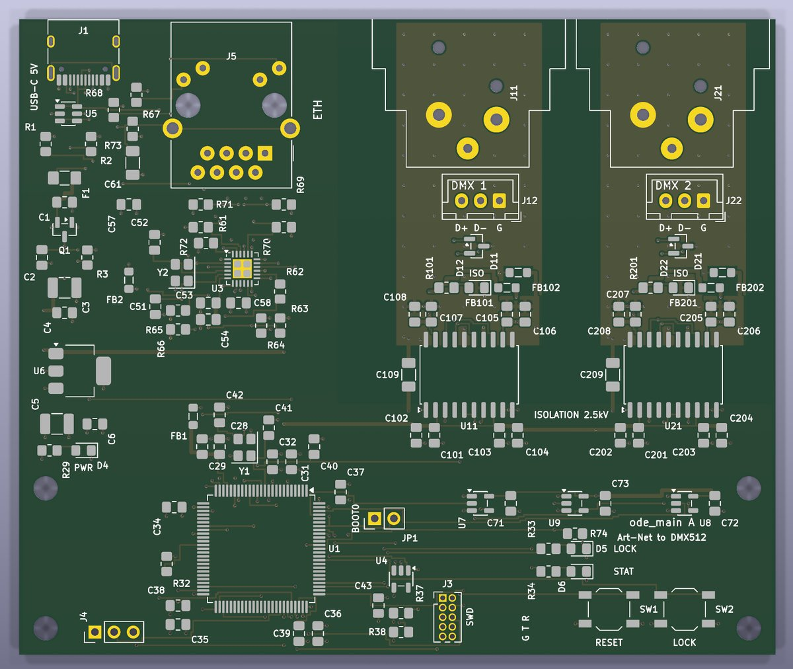

# ODE-DIY — 自作の Art-Net / sACN → DMX512 ノード

Art-Net と sACN（E1.31）を LAN で受けて DMX512 を出す、手作りの照明用ノード（「箱」）。照明操作ソフト miseru の画面を本体に内蔵し、ブラウザから WebSocket で照明を動かせる。

A DIY Art-Net / sACN to DMX512 node with a built-in web UI (miseru) over HTTP/WebSocket.

## 版

| 版 | マイコン | 状態 | 場所 |
|---|---|---|---|
| rev A | STM32F407VGT6 + LAN8742A（有線 LAN） | 基板を作って手実装 1 台が動いている。実機に書き込んで動いているのはファーム v0.3.0。このリポジトリのファームは v0.3.6（v0.3.1 以降は試験版（Linux）でだけ確認） | [hardware/revA](hardware/revA/) |
| rev B | ESP32-S3-WROOM-1-N16R8 + W5500（Wi-Fi と有線の併用） | **作業中**。本体の回路図と PCB、天板の回路図と PCB まで（どれも未発注で、まだ直している。版はそれぞれの README）。ファームはこれから | [hardware/revB](hardware/revB/) |

## フォルダ

- `hardware/revA/ode_main/` … rev A の KiCad 一式、ガーバー（JLCPCB 用 4 層）、部品リスト、レビューと立ち上げの記録
- `hardware/revA/case/` … ケース板（天板・底板、基板材で作る）
- `hardware/revB/ode_main/`・`ode_top/` … rev B の本体と天板の回路図・PCB、ケースの寸法モデル、構成案、点検記録
- `firmware/` … ファーム。機種に依らない部分（`app/`）と機種ごとの部分（`port/stm32/`、Linux で試す `port/host/`）に分かれている。rev B は `port/esp32/` を足す予定。ビルド・書き込み・試し方は [firmware/README.md](firmware/README.md)
- `docs/websocket-spec.md` … miseru と箱のあいだの WebSocket とロックの仕様
- `tools/` … 試験用の小さな道具（sACN の送信など）

## できること（rev A、ファーム v0.3.6）

- Art-Net 4（ArtPoll / ArtDmx）と sACN を受けて DMX 1 ユニバースを出す
- 本体に miseru の画面を内蔵（差し替え可）。WebSocket で操作し、送り手を 1 つにロックする
- `/setup` で PIN の変更と画面の差し替え（LOCK ボタン SW2 を 3 秒押してから 10 分の間だけ）。SW2 を 10 秒押すと USB DFU のファーム更新モード（**実機では未確認**）
- 初期値: IP 192.168.1.223、マスク 255.255.255.0、PIN 1234（本体ボタンで初期化）。家の LAN が 192.168.1.x のときは、PC と直結するか番号が重ならないか確かめる

## 基板の図

## ライセンス

- 基板・ケース（`hardware/`）: [CERN-OHL-P-2.0](LICENSE-HARDWARE)。著作者表示は [hardware/NOTICE](hardware/NOTICE)
- 仕様の文書（`docs/websocket-spec.md`）: [MIT](LICENSE-FIRMWARE)。基板の図（`docs/img/`）: [CERN-OHL-P-2.0](LICENSE-HARDWARE)（著作者表示は [hardware/NOTICE](hardware/NOTICE)）
- ファーム・道具・スクリプト（`firmware/`、`tools/`、`hardware/` の中の `*.py`・`*.sh`）: [MIT](LICENSE-FIRMWARE)
- 同梱の外部のもの（それぞれのライセンスに従う）
  - lwIP（BSD-3-Clause、`firmware/vendor/lwip/COPYING`）
  - CMSIS と STM32F4 のデバイスファイル（Apache-2.0、`firmware/vendor/cmsis/LICENSE.txt`・`firmware/vendor/cmsis_f4/LICENSE.md`）。`firmware/port/stm32/startup_stm32f407xx.s` と `system_stm32f4xx.c` も STMicroelectronics 製で Apache-2.0
  - `firmware/app/assets_gen.c` は miseru のビルド済みの画面（ライセンスは公開版 miseru の LICENSE を参照）で、React（MIT）などを含む
  - KiCad 標準ライブラリの記号と足の形（CC-BY-SA 4.0、設計への利用は例外で自由）
- ENTTEC・ODE は ENTTEC 社の商標。このプロジェクトは ENTTEC 社と関係がない

## 注意

個人の手作りの記録です。動作は保証しません。商用の DMX 機器と同じ安全基準での試験はしていません。
